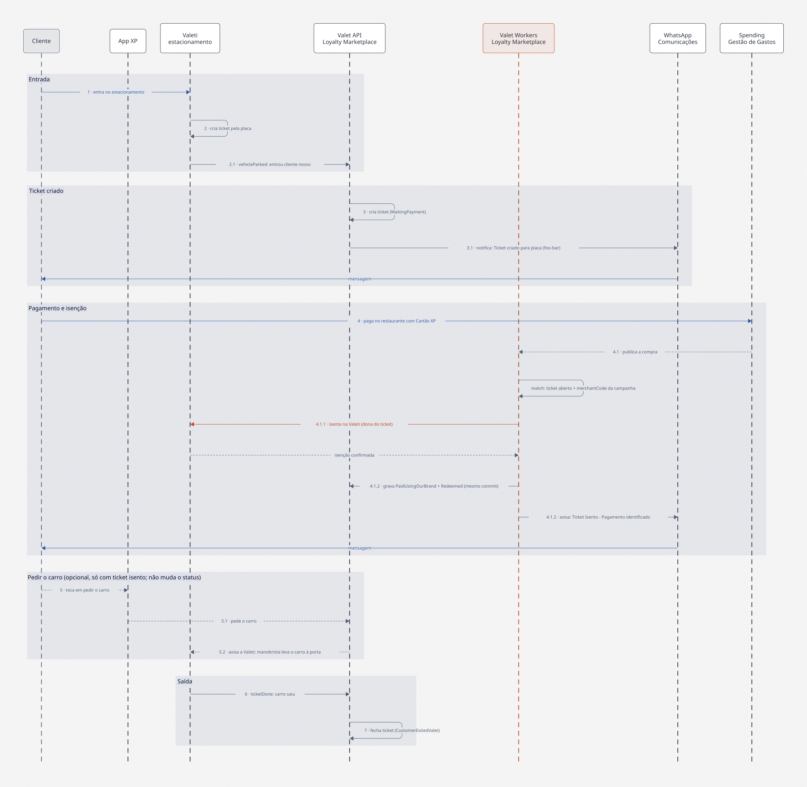
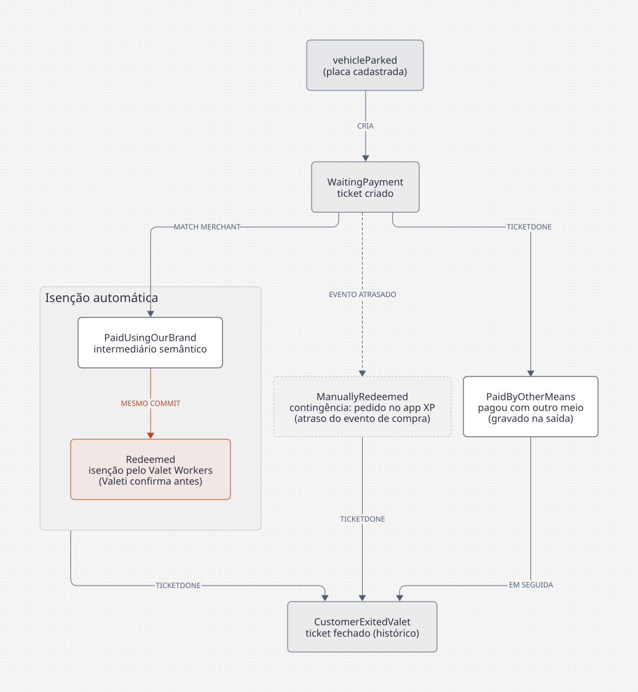

# Diagramas do projeto Valet (benefício Cartão XP · parceira Valeti)

Pacote para a documentação, uma pasta por cenário. Gerado por `scripts/valet-docs.sh`
no `designer-studio`; fontes em `scenes/xp-valet-*.toml` (widget passo a passo) e
`d2/xp-valet-*.d2` (sequência e estados). Time dono: **Loyalty Marketplace**.

```sh
cd ~/projects/designer-studio
sh scripts/valet-docs.sh
```

## Estrutura

```
estados/                     ciclo de vida do ticket, comum aos cenários
01-isencao-automatica/       WaitingPayment → Redeemed (isenção automática)
02-isencao-manual/           WaitingPayment → ManuallyRedeemed (contingência)
03-pago-outro-meio/          WaitingPayment → PaidByOtherMeans → CustomerExitedValet
```

Dentro de cada cenário:

| Arquivo | O quê |
|---|---|
| `animado-light.svg` / `animado-dark.svg` | animação passo a passo, **sem JavaScript**: roda como imagem no markdown |
| `estatico-light.svg` / `estatico-dark.svg` | estado final, imagem parada |
| `interativo.html` | widget clicável (passos, claro/escuro). Precisa ser hospedado |
| `sequencia-light.svg` / `.png` (e `-dark`) | ordem das mensagens |
| `passos/passo-NN.png` | um PNG por passo |
| `passos/grade.png` | todos os passos numa grade |
| `passos/completo.png` | tudo visível, sem controles |

## Como usar no markdown

Imagem comum funciona em qualquer renderizador. Os SVG são autocontidos (fontes
embutidas, sem JavaScript, sem recurso externo), então abrem iguais em qualquer lugar:

```md




```

A animação do `animado-*.svg` é CSS `@keyframes` dentro do próprio SVG: ela roda
quando o arquivo é usado como imagem (``), que é o caso do markdown.
Com `prefers-reduced-motion` ligado, o SVG mostra o estado final parado.

Sem MP4 nem GIF no pacote: a wiki recebe SVG, PNG e HTML.

## O widget interativo

O `interativo.html` não roda colado no markdown: ele tem `style` e `script`, e o
GitHub remove isso. Duas saídas:
- **Astro:** se a wiki serve arquivos de `public/`, suba o HTML lá e linke no
  markdown (`[Diagrama interativo](…/interativo.html)`), ou embuta num `<iframe>`;
  o Astro não sanitiza o markdown por padrão.
- **GitHub puro:** no site da wiki vale o link/iframe; na visualização do `.md`
  dentro do github.com não funciona, então use o `animado-*.svg`.

Atalhos na URL do interativo: `?step=N` abre no passo N; `?past=0` mostra tudo sem
esmaecer; `?appearance=dark` abre no escuro; `?chrome=0` esconde os controles.
